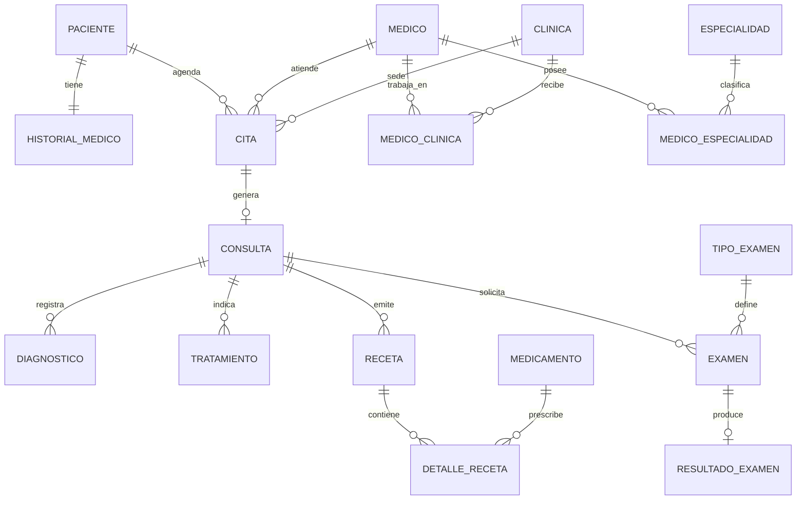

# Modelo De Entidades - Clinica Medica

Este documento define el modelo de dominio propuesto para el sistema de clinica medica. El alcance actual es clinico basico: pacientes, medicos, especialidades, citas, consultas, historial medico, recetas, tratamientos, examenes, medicamentos y clinicas.

## Entidades Principales

| Entidad | Responsabilidad |
|---|---|
| `Clinica` | Sedes donde se presta atencion medica. |
| `Paciente` | Datos personales y de contacto del paciente. |
| `HistorialMedico` | Resumen clinico permanente del paciente. |
| `Medico` | Datos personales y profesionales del medico. |
| `Especialidad` | Catalogo de especialidades medicas. |
| `MedicoClinica` | Relacion entre medicos y clinicas donde atienden. |
| `MedicoEspecialidad` | Relacion entre medicos y especialidades. |
| `Cita` | Programacion de una atencion medica. |
| `Consulta` | Atencion medica efectivamente realizada. |
| `Diagnostico` | Diagnosticos registrados durante una consulta. |
| `Tratamiento` | Plan terapeutico indicado al paciente. |
| `Receta` | Encabezado de una prescripcion medica. |
| `DetalleReceta` | Medicamentos, dosis e indicaciones de una receta. |
| `Medicamento` | Catalogo de medicamentos. |
| `TipoExamen` | Catalogo de examenes disponibles. |
| `Examen` | Solicitud medica de examen. |
| `ResultadoExamen` | Resultado asociado a una solicitud de examen. |

Nota: el nombre recomendado es `Medicamento`, no `Medicamente`.

## Relaciones Generales

```text
Medico      N -- N Clinica       mediante MedicoClinica
Medico      N -- N Especialidad  mediante MedicoEspecialidad

Paciente    1 -- 1 HistorialMedico
Paciente    1 -- N Cita
Medico      1 -- N Cita
Clinica     1 -- N Cita

Cita        1 -- 0..1 Consulta
Consulta    1 -- N Diagnostico
Consulta    1 -- N Tratamiento
Consulta    1 -- N Receta
Consulta    1 -- N Examen

Receta      1 -- N DetalleReceta
Medicamento 1 -- N DetalleReceta

TipoExamen  1 -- N Examen
Examen      1 -- 0..1 ResultadoExamen
```

## Diagrama Mermaid



## Detalle De Campos

### `Clinica`

| Campo | Tipo sugerido | Regla |
|---|---|---|
| `id` | `Long` | Identificador. |
| `nombre` | `String` | Obligatorio. |
| `direccion` | `String` | Obligatoria. |
| `telefono` | `String` | Obligatorio. |
| `correo` | `String` | Opcional. |
| `horarioAtencion` | `String` | Opcional inicialmente. |
| `activo` | `Boolean` | Para desactivacion logica. |
| `creadoEn` | `LocalDateTime` | Auditoria. |
| `actualizadoEn` | `LocalDateTime` | Auditoria. |

### `Paciente`

La entidad actual `Paciente` deberia ampliarse. No conviene exigir DPI a todos los pacientes porque menores de edad o extranjeros podrian no tenerlo.

| Campo | Tipo sugerido | Regla |
|---|---|---|
| `id` | `Long` | Identificador. |
| `nombres` | `String` | Obligatorio. |
| `apellidos` | `String` | Obligatorio. |
| `tipoIdentificacion` | `Enum` | DPI, pasaporte, nacimiento u otro. |
| `numeroIdentificacion` | `String` | Unico cuando exista. |
| `fechaNacimiento` | `LocalDate` | Obligatoria. |
| `sexoBiologico` | `Enum` | Opcional, util para contexto clinico. |
| `telefono` | `String` | Opcional. |
| `correo` | `String` | Opcional. |
| `direccion` | `String` | Opcional. |
| `contactoEmergencia` | `String` | Opcional. |
| `telefonoEmergencia` | `String` | Opcional. |
| `activo` | `Boolean` | Para desactivacion logica. |
| `creadoEn` | `LocalDateTime` | Auditoria. |
| `actualizadoEn` | `LocalDateTime` | Auditoria. |

### `HistorialMedico`

Debe almacenar el perfil clinico general del paciente, no copias de consultas, recetas ni examenes.

| Campo | Tipo sugerido | Regla |
|---|---|---|
| `id` | `Long` | Identificador. |
| `paciente` | `Paciente` | Relacion `@OneToOne`, unica y obligatoria. |
| `tipoSangre` | `String` | Opcional. |
| `alergias` | `String` | Texto clinico. |
| `enfermedadesCronicas` | `String` | Texto clinico. |
| `antecedentesPersonales` | `String` | Texto clinico. |
| `antecedentesFamiliares` | `String` | Texto clinico. |
| `cirugiasPrevias` | `String` | Texto clinico. |
| `medicamentosHabituales` | `String` | Texto clinico. |
| `observaciones` | `String` | Informacion relevante. |
| `actualizadoEn` | `LocalDateTime` | Ultima actualizacion. |

### `Medico`

| Campo | Tipo sugerido | Regla |
|---|---|---|
| `id` | `Long` | Identificador. |
| `nombres` | `String` | Obligatorio. |
| `apellidos` | `String` | Obligatorio. |
| `numeroColegiado` | `String` | Unico y obligatorio. |
| `telefono` | `String` | Opcional. |
| `correo` | `String` | Unico cuando exista. |
| `activo` | `Boolean` | Para desactivacion logica. |
| `creadoEn` | `LocalDateTime` | Auditoria. |
| `actualizadoEn` | `LocalDateTime` | Auditoria. |

### `Especialidad`

| Campo | Tipo sugerido | Regla |
|---|---|---|
| `id` | `Long` | Identificador. |
| `nombre` | `String` | Unico y obligatorio. |
| `descripcion` | `String` | Opcional. |
| `activo` | `Boolean` | Para desactivacion logica. |

### `MedicoClinica`

Debe usarse en lugar de un `@ManyToMany` directo porque la relacion puede tener datos propios.

| Campo | Tipo sugerido | Regla |
|---|---|---|
| `id` | `Long` | Identificador. |
| `medico` | `Medico` | Relacion `@ManyToOne`, obligatoria. |
| `clinica` | `Clinica` | Relacion `@ManyToOne`, obligatoria. |
| `consultorio` | `String` | Opcional. |
| `fechaIngreso` | `LocalDate` | Opcional. |
| `activo` | `Boolean` | Indica si aun trabaja en esa sede. |

Restriccion recomendada: combinacion unica `medico + clinica`.

### `MedicoEspecialidad`

Debe usarse en lugar de un `@ManyToMany` directo porque la relacion puede tener datos propios.

| Campo | Tipo sugerido | Regla |
|---|---|---|
| `id` | `Long` | Identificador. |
| `medico` | `Medico` | Relacion `@ManyToOne`, obligatoria. |
| `especialidad` | `Especialidad` | Relacion `@ManyToOne`, obligatoria. |
| `principal` | `Boolean` | Indica especialidad principal. |
| `numeroCertificacion` | `String` | Opcional. |
| `activo` | `Boolean` | Estado de la relacion. |

Restriccion recomendada: combinacion unica `medico + especialidad`.

### `Cita`

| Campo | Tipo sugerido | Regla |
|---|---|---|
| `id` | `Long` | Identificador. |
| `paciente` | `Paciente` | Relacion `@ManyToOne`, obligatoria. |
| `medico` | `Medico` | Relacion `@ManyToOne`, obligatoria. |
| `clinica` | `Clinica` | Relacion `@ManyToOne`, obligatoria. |
| `fechaHoraInicio` | `LocalDateTime` | Obligatoria. |
| `fechaHoraFin` | `LocalDateTime` | Obligatoria y posterior al inicio. |
| `motivo` | `String` | Obligatorio. |
| `estado` | `EstadoCita` | Obligatorio. |
| `observaciones` | `String` | Opcional. |
| `creadoEn` | `LocalDateTime` | Auditoria. |
| `actualizadoEn` | `LocalDateTime` | Auditoria. |

Estados sugeridos:

```java
PROGRAMADA,
CONFIRMADA,
ATENDIDA,
CANCELADA,
NO_ASISTIO
```

Reglas:

- El medico debe estar activo en la clinica seleccionada.
- No deben existir citas solapadas para el mismo medico.
- `fechaHoraFin` debe ser posterior a `fechaHoraInicio`.
- Una cita cancelada no debe generar consulta.

### `Consulta`

La cita representa agenda; la consulta representa atencion medica. Deben mantenerse separadas.

| Campo | Tipo sugerido | Regla |
|---|---|---|
| `id` | `Long` | Identificador. |
| `cita` | `Cita` | Relacion `@OneToOne`, unica y obligatoria. |
| `fechaHora` | `LocalDateTime` | Obligatoria. |
| `motivoConsulta` | `String` | Obligatorio. |
| `sintomas` | `String` | Opcional. |
| `examenFisico` | `String` | Opcional. |
| `observaciones` | `String` | Opcional. |
| `planGeneral` | `String` | Opcional. |
| `creadoEn` | `LocalDateTime` | Auditoria. |

Regla: una consulta no debe existir sin una cita atendida.

Nota futura: puede agregarse `SignosVitales` para presion arterial, temperatura, peso, talla, frecuencia cardiaca y saturacion.

### `Diagnostico`

| Campo | Tipo sugerido | Regla |
|---|---|---|
| `id` | `Long` | Identificador. |
| `consulta` | `Consulta` | Relacion `@ManyToOne`, obligatoria. |
| `codigoCie10` | `String` | Opcional. |
| `descripcion` | `String` | Obligatoria. |
| `tipo` | `TipoDiagnostico` | Presuntivo, confirmado o descartado. |
| `principal` | `Boolean` | Indica diagnostico principal. |
| `observaciones` | `String` | Opcional. |

Tipos sugeridos:

```java
PRESUNTIVO,
CONFIRMADO,
DESCARTADO
```

### `Tratamiento`

El tratamiento representa el plan terapeutico general: dieta, reposo, terapia, procedimientos u otras indicaciones. Los medicamentos deben manejarse mediante recetas.

| Campo | Tipo sugerido | Regla |
|---|---|---|
| `id` | `Long` | Identificador. |
| `consulta` | `Consulta` | Relacion `@ManyToOne`, obligatoria. |
| `diagnostico` | `Diagnostico` | Relacion opcional. |
| `descripcion` | `String` | Obligatoria. |
| `indicaciones` | `String` | Obligatorias. |
| `fechaInicio` | `LocalDate` | Obligatoria. |
| `fechaFin` | `LocalDate` | Opcional. |
| `estado` | `EstadoTratamiento` | Obligatorio. |
| `observaciones` | `String` | Opcional. |

Estados sugeridos:

```java
PLANIFICADO,
ACTIVO,
COMPLETADO,
SUSPENDIDO
```

### `Receta`

La receta es el encabezado de la prescripcion. Los medicamentos se registran en `DetalleReceta`.

| Campo | Tipo sugerido | Regla |
|---|---|---|
| `id` | `Long` | Identificador. |
| `consulta` | `Consulta` | Relacion `@ManyToOne`, obligatoria. |
| `fechaEmision` | `LocalDateTime` | Obligatoria. |
| `indicacionesGenerales` | `String` | Opcional. |
| `estado` | `EstadoReceta` | Emitida o anulada. |
| `observaciones` | `String` | Opcional. |

Estados sugeridos:

```java
EMITIDA,
ANULADA
```

Regla: una receta emitida no deberia eliminarse ni modificarse silenciosamente. Si contiene un error, debe anularse y generarse otra.

### `Medicamento`

| Campo | Tipo sugerido | Regla |
|---|---|---|
| `id` | `Long` | Identificador. |
| `nombreGenerico` | `String` | Obligatorio. |
| `nombreComercial` | `String` | Opcional. |
| `presentacion` | `String` | Tableta, jarabe, ampolla, etc. |
| `concentracion` | `String` | Ejemplo: 500 mg. |
| `activo` | `Boolean` | Para desactivacion logica. |

No se incluye inventario en este alcance.

### `DetalleReceta`

| Campo | Tipo sugerido | Regla |
|---|---|---|
| `id` | `Long` | Identificador. |
| `receta` | `Receta` | Relacion `@ManyToOne`, obligatoria. |
| `medicamento` | `Medicamento` | Relacion `@ManyToOne`, obligatoria. |
| `dosis` | `String` | Obligatoria. |
| `frecuencia` | `String` | Obligatoria. |
| `duracion` | `String` | Obligatoria. |
| `viaAdministracion` | `String` | Obligatoria. |
| `cantidad` | `String` | Opcional. |
| `indicaciones` | `String` | Opcional. |

### `TipoExamen`

| Campo | Tipo sugerido | Regla |
|---|---|---|
| `id` | `Long` | Identificador. |
| `nombre` | `String` | Unico y obligatorio. |
| `categoria` | `String` | Laboratorio, imagen, cardiologia, etc. |
| `descripcion` | `String` | Opcional. |
| `activo` | `Boolean` | Para desactivacion logica. |

### `Examen`

| Campo | Tipo sugerido | Regla |
|---|---|---|
| `id` | `Long` | Identificador. |
| `consulta` | `Consulta` | Relacion `@ManyToOne`, obligatoria. |
| `tipoExamen` | `TipoExamen` | Relacion `@ManyToOne`, obligatoria. |
| `fechaSolicitud` | `LocalDateTime` | Obligatoria. |
| `prioridad` | `PrioridadExamen` | Normal o urgente. |
| `estado` | `EstadoExamen` | Obligatorio. |
| `indicaciones` | `String` | Opcional. |

Prioridades sugeridas:

```java
NORMAL,
URGENTE
```

Estados sugeridos:

```java
SOLICITADO,
PROGRAMADO,
REALIZADO,
RESULTADO_DISPONIBLE,
CANCELADO
```

### `ResultadoExamen`

| Campo | Tipo sugerido | Regla |
|---|---|---|
| `id` | `Long` | Identificador. |
| `examen` | `Examen` | Relacion `@OneToOne`, unica y obligatoria. |
| `fechaResultado` | `LocalDateTime` | Obligatoria. |
| `resultado` | `String` | Texto del resultado. |
| `conclusion` | `String` | Interpretacion o conclusion. |
| `archivoUrl` | `String` | Referencia al documento. |
| `observaciones` | `String` | Opcional. |

Regla: no guardar archivos binarios directamente en la base de datos. Guardar una referencia o URL.

## Roles Futuros

No se implementara autenticacion por ahora, pero estos roles ayudan a delimitar responsabilidades cuando se agregue seguridad.

| Rol | Responsabilidad |
|---|---|
| `ADMINISTRADOR` | Gestiona clinicas, medicos, especialidades y catalogos. |
| `RECEPCIONISTA` | Gestiona pacientes y citas; no modifica informacion clinica. |
| `MEDICO` | Registra consultas, diagnosticos, tratamientos, recetas y solicitudes de examen. |
| `ENFERMERIA` | Registra signos vitales y preparacion del paciente, si se implementa ese modulo. |
| `LABORATORIO` | Registra resultados de examenes. |
| `AUDITOR` | Consulta registros sin modificarlos. |

Cuando se implemente seguridad, las entidades sugeridas seran:

```text
Usuario
Rol
UsuarioRol
```

Regla importante: no mezclar roles con `Medico`, `Paciente` o `Clinica`. Un medico es una entidad del negocio; un usuario es una identidad para iniciar sesion.

## Reglas Generales De Implementacion

- No eliminar fisicamente consultas, diagnosticos, recetas, tratamientos ni resultados.
- Usar `activo` para medicos, clinicas, especialidades, medicamentos y otros catalogos.
- Usar fechas de creacion y actualizacion en entidades principales.
- Evitar `CascadeType.REMOVE` desde paciente, medico o clinica hacia informacion clinica.
- No devolver entidades JPA directamente desde controladores; usar DTOs.
- No exponer el historial completo cuando solamente se solicita una cita.
- Mantener `Cita` y `Consulta` separadas.
- Mantener `Receta` y `Tratamiento` separados.
- Validar reglas de negocio en servicios, no solamente en controladores.
- Mantener las relaciones `MedicoClinica` y `MedicoEspecialidad` como entidades intermedias, no como `@ManyToMany` directo.

## Orden Sugerido De Implementacion

1. `Clinica`, `Medico`, `Especialidad`, `MedicoClinica` y `MedicoEspecialidad`.
2. Ampliacion de `Paciente` y creacion de `HistorialMedico`.
3. `Cita` con validacion de medico, clinica y horario.
4. `Consulta` y `Diagnostico`.
5. `Tratamiento`.
6. `Medicamento`, `Receta` y `DetalleReceta`.
7. `TipoExamen`, `Examen` y `ResultadoExamen`.
8. DTOs, mappers, repositorios, servicios y controladores.
9. Pruebas de relaciones, conflictos de agenda y flujo clinico.
